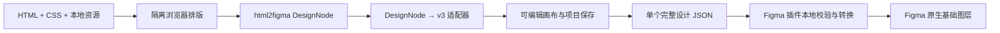

# Design Studio 0.20：HTML、DesignNode、v3 与 Figma 转换方案

更新：2026-10-16。目标是在独立 Panel 中完成 HTML 导入、编辑、完整文件保存及
Figma 插件还原，沿用现有 7 项 Host 权限，不让安装包依赖另一个本机仓库或服务。

## 转换路径



v3 是编辑与存档的权威模型。DesignNode 是 HTML 转换中间层；Figma transfer 是
插件执行中间层。完整文件无需用户再手动生成 transfer，插件在内部完成转换。
已有官方 Figma 来源 JSON → v3 → 原节点补丁的流程保持独立，HTML 导入的新设计
默认在 Figma 创建新页面，不声称能定位一个从未绑定过的原 Figma 文件。

## 模块与接口

| 层              | 实现                                            | 契约                                                                                         |
| --------------- | ----------------------------------------------- | -------------------------------------------------------------------------------------------- |
| 浏览器转换      | `app/vendor/html2figma-browser.mjs`             | `convertToDesignDSL(root, options)`；使用 root 自己的 window/document realm                  |
| HTML 与资源准备 | `app/html-import.mjs`、`html-import-assets.mjs` | 本地 CSS/资源解析；隔离脚本和网络；`captureWorkspaceHtmlResult` 返回完整转换结果             |
| 纯适配层        | `app/design-node-adapter.mjs`                   | `designNodeToV3(tree, options)` → document、resourcePlans、resourcePayloads、mapping、report |
| 项目保存        | 编辑器与既有 resource-store                     | 先提交有界不可变资源分片，再替换设计；遵守项目和设计版本检查                                 |
| 单文件          | 既有 portable-backup v2                         | v3 document + 经 SHA-256 校验的资源字节 + 评论/来源/原型附件                                 |
| 插件文件入口    | `app/figma-plugin/v3-input.mjs`                 | `preparePluginFile(text)` → 经校验 transfer、文件类型、提示和数量                            |
| Figma 创建      | 既有 `app/figma-plugin/code.js`                 | 接收正常 import-transfer 消息，创建新页面与基础图层                                          |

上游固定为 html2figma `ea78385c7ab8cb251d5f0cc10213dea4a93e9a7c`，只引入
DOM → DesignNode 所需源。`third-party/html2figma/sources.json` 记录原文件摘要，
`build.json` 记录生成物和 esbuild 版本，许可声明随安装包携带。源码快照可独立重建，
不调用加密 `.dsl` 服务、不上传图片、不访问另一个 checkout。

```sh
node scripts/build-html2figma-browser.mjs --check
node scripts/build-design-studio-figma-plugin.mjs --check
npm test -- --suite design-studio
```

两个检查纳入默认完整门禁。插件 UI 内嵌生成的纯转换代码，Figma sandbox 中没有
运行时模块导入或本机路径；共享 schema 变化后必须重新生成插件 UI。

## 映射与资源规则

- 上游最终 DesignNode bounds 为父级相对坐标，适配器累加为 v3 页面坐标；嵌套旋转
  反算中心与尺寸，无法精确恢复的退化变换给出提示。
- ID 由结构路径和语义标识摘要组成，不使用随机时间戳 ID，也不把可重复 semanticId
  直接当作唯一 ID。文字保留为 text，容器为 frame，基础 Flex/Grid/Wrap 映射到 v3 布局。
- 图片优先保留安全 src 内的原始本地字节，避免浏览器 canvas 重编码改变资源。
  SVG 只允许自包含惰性内容和内部 ID 引用。字体按 family/weight/style 与文字匹配。
- 浏览器文件夹导入读取用户选择的文件；工作区接口只读允许的文本，不新增二进制
  读取权限。普通工作区路径可以引用本地 CSS、内嵌 data 图片/字体；本地二进制请
  选择文件夹一起导入。单项资源最多 8 MiB，图片/字体合计最多 12 MiB。
- 原始 HTML 和 CSS 合计最多 512 KiB，最多 20 个直接引用样式表。浏览器以指定视口
  排版；v3 用裁剪 Frame 展示首屏，完整子图层仍可编辑。
- 普通 v3 的资源描述符不携带字节，因此资源非空时插件要求完整文件。完整包最大
  128 MiB，所有资源与附件先验证；实际 Figma transfer 仍受 16 MiB 限制，大图应分页面。

## 保真边界

完整文件保证已转换 v3 及其依赖可独立恢复，不等于保留所有 HTML/CSS 语义。
渐变、独立填充透明度、混合富文本、不同方向边框、多重阴影和滤镜等超出 v3 的
表达能力时返回明确 diagnostics；有界 HTML 语义保存在节点 notes 中。HTML 脚本、
事件与网络资源不会执行，远程资源不会在转换时下载。

Figma 还原使用原生文字、Frame 和基础图片图层。SVG 资源可能转为 PNG 供现有图片
创建 API 使用，不声称已恢复成可编辑矢量路径。字体文件可在完整包中保存和校验，
Figma Plugin API 不提供安装字体字节的能力，仍依赖本机字体或明确的回退提示。
评论和原型附件先校验，当前不转换成 Figma 云端评论或原型动作。

## 验收记录

独立测试覆盖跨 iframe realm、上游源码独立重建、稳定 ID、相对坐标与旋转、响应式
排版、本地资源和字体、完整包完整性、插件直接 v3/portable 输入与大 Base64 数据。
真实 Chromium 应用流程覆盖选择 HTML 文件夹 → 导入 → 修改标题 → 保存重开 →
下载完整文件 → 插件转换器读取，并核对原 PNG 字节不变。

- Design Studio 独立门禁：230/230 通过，日志 `/tmp/design-studio-html2figma-design-final.log`。
  保存重入测试明确区分函数级回归与真实 UI 的 inert 门禁；坏字体和 CSS 背景图在
  任何项目写入和设计替换之前拒绝。`normal`/`bold` 字体声明分别映射为 400/700。
- 五组真实 Node Host 存储和运行时验收通过，日志 `/tmp/design-studio-html2figma-host.log`；
  仅使用临时 HOME 与项目，验证字节、文本预算、CAS、来源恢复和完整备份。
- 真实 Figma 还原通过，证据保存在主仓库
  `artifacts/design-studio-figma-plugin/acceptance-runs/real-figma-html-v3-1792130934027-6d740ada/report.json`。
  HTML 经实际浏览器转换为 v3，修改标题后生成一个完整备份；正式 UI 转换器校验并转换，
  未改动的生产 main 创建 1 个自有新页面、10 个图层（2 文字、1 图片）。再次官方导出
  核对层级、文字与全部几何，最大误差小于 0.000014 px，PNG 原字节 SHA-256 为
  `431ced6916a2a21a156e38701afe55bbd7f88969fbbfc56d7fe099d47f265460`，始终一致。
  本轮使用临时 UI 附加代码发送正常插件消息；不等同于原生文件选择器鼠标全链验收。
  临时服务已退出，测试 UI 和网络权限已移除，清理记录为同目录 `08-cleanup-receipt.json`。

最终全仓门禁、干净提交 Desktop 安装验收和个人安装版本将在完成后补充。
