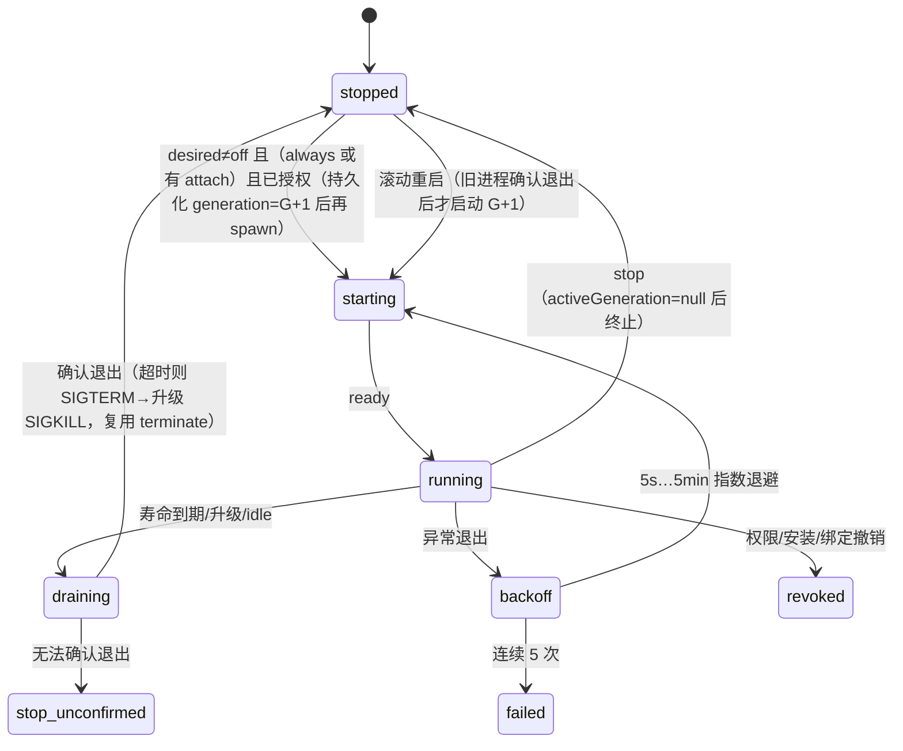

# 投资行情后台共享更新与首屏优化技术方案

作者：Claude Code；主代理附独立复核约束；日期：2026-10-28。

状态：两个授权 worktree 已实施候选代码，待 CC 验收。架构主线为 Host 托管的共享后台服务；第 11 节优先约束和第 12 节的实施裁决共同定义最终协议。第 0—11 节保留原设计与审查时的证据快照，其中“未实施”和“未定项”不是当前交付状态。实际实施基线为 Panel `84348855be8ae4e5a31936b3c2b0d1d21410bd64`、Host `c0a38310cc26c49bca230a00d6df8c9fabf79f7e`，没有引入原主目录其他任务的提交。测试结果以实施根 HANDOFF.json 为准，不以本方案中的目标代替实测证据。

## 0. 基线与证据边界

| 项 | 值 |
|---|---|
| Panel 仓库 | `main` @ `36cb880540c7c6a4f83efda71e2ab6c1536c81bf`，工作树干净。旧草案 `20d7f21` 基于 `8434885`；两者在 quant-lab、video-download、job-hunt-hq、design-studio、starter 目录下的 diff 为空，所以 Quant 的行号一致。 |
| Host 仓库 | HEAD `c0a38310cc26c49bca230a00d6df8c9fabf79f7e`，分支 `chore/drop-legacy-panel-baseline`。工作区里有其他任务尚未提交的改动（installer、legacy-packages、package-snapshots、e2e-shared-panel-tasks、management）。本文引用的 Host 行号来自**工作区文件**，不是“干净的 main”，也**没有和正在运行的二进制比对**。`management.ts` 只作为集成点名称引用，具体行号以实施时为准。本方案不改动这些文件。 |
| 版本 | Quant 0.47.0、Video Download 0.24.1、Video Studio 0.10.0、Job Hunt HQ 5.1.0、Design Studio 0.23.0、Starter 0.1.1 |
| 没有做的事 | 现场选包、PID、锁文件、耗时取证；任何测试的执行。文中的目标和验收项都处于**待验证**状态。 |

---

## 1. 架构裁决

### 1.1 必需交付

用户启用“后台更新”后，只要 CodeShell Host 还在运行，即使所有投资 webview 都关了，行情也要由 Host 托管持续采集，结果写入共享快照；多个窗口和会话打开时 attach 到同一个服务，不各自采集。

Host 正常退出时可以停止；Host 重启后按持久化的 desired 状态恢复；权限被撤销时立即停止。不要求在 Host 退出后仍常驻系统。

### 1.2 为什么现有 Host 能力不够

源码已经能说明三点：

1. `process.spawn` 起的子进程归 webview guest 所有，关闭面板时会被杀掉（`process-service.ts:1067-1090`），每个 guest 最多 3 个（`:624-630`）。
2. durable task 共用的是**全局** 2 个并发槽（`tool-jobs.ts:12,742,754`）。一个无限期运行的任务会长期占掉媒体和下载的一半执行能力。它作为 execution-gate 的执行持有者（`tool-jobs.ts:307`），还会阻塞包升级（`execution-gate.ts:96-126`）。单进程最长 24 小时、累计输出最多 4MB（`process-state.ts:10-11`）。
3. Host automation 的唯一键里包含 sessionId（`automations.ts:33-41`），本质是经过 agent 的 CronJob，不能当项目级的行情心跳用。

所以“Host 授权的后台服务通道”是**已经证实的通用能力缺口**，本方案把它列为必做阶段 H1–H3，不再等 P0 证据。

### 1.3 各类场景的执行方式

| 场景 | 机制 |
|---|---|
| 投资行情（唯一消费者） | **新增 Host 通用能力 Panel Background Services**：已审查入口、Host 作为父进程、单实例、独立的预算池、提交点由 Host 原子仲裁 |
| 有界且需要关页后继续的工作（下载、媒体/渲染、转写、Quant 历史分块） | 现有 Host durable task + requestKey + 先 `tasks.find` 再发起 |
| 项目文件型 CLI（Job Hunt、Design Studio、Starter、`quant-lab.mjs`、Video Download 私有队列） | 保留现有锁和 CAS，只修已证实的缺陷 |
| 旧 Host 没有 services 能力时的投资行情 | **过渡降级**：webview 之间用单记录 storage CAS 选出一个持有者，跑有界短轮次。这只在有窗口存活时生效，UI 明确标注“需要更新 CodeShell 才能关闭面板后继续” |

不把所有 Panel 都服务化，不自建绕过授权的 detached daemon。

### 1.4 四个复用层次（实施时不得混用这些词）

- **同程序**：同一个 nativeEntry 的字节。
- **同持久记录**：Host service channel，或单个 storage key。
- **同逻辑任务**：同一个 service scope 或同一个 requestKey。
- **同常驻 PID**：只有 Background Service 的当前 generation 才算。

---

## 2. Host 通用能力：Panel Background Services（Host 仓库，H1–H3）

### 2.1 声明与授权

core `manifest.ts` 新增 permission `background.services`，以及 strict 校验的 `backgroundServices` 字段：

```json
"permissions": [..., "process", "background.services"],
"backgroundServices": {
  "market-feed": {
    "entry": "quant-market-service",
    "channels": { "quotes": { "maxBytes": 262144 } },
    "maxLifetimeMs": 21600000,
    "idleGraceMs": 60000
  }
}
```

- 校验规则：`entry` 必须是已声明的 nativeEntry；必须同时有 `process` 和 `context.workspace` 权限。权限在安装或升级时由用户确认（复用现有的权限变更流程）。
- 运行时授权：每次 spawn 前和每 5 分钟各复核一次，内容是“应用已安装、在这个项目里被选中、revision 一致、权限仍然授予”，复用 tool job 已有的 `installedToolApp(scope)` 判定（`panel-app-bridge.ts:1855` 附近）。

### 2.2 身份、发现与隔离

- 身份：`serviceKey = (appId, panelExecutionProject(projectPath), serviceName)`。这里的 projectPath 是 realpath 后的结果（`execution-gate.ts:22-28`）。同一 serviceKey 任何时刻**最多只有一个 generation 在运行**，revision 作为属性记录。
- 发现：webview 只能按自己 manifest 里的 serviceName 寻址；跨 app 的访问由 guest owner 隔离拒绝。
- 不对外暴露 PID。

### 2.3 Webview 接口（通过 `availableMethods` 和 `capabilities.services.version` 探测）

```ts
services.get({name}) -> ServiceState
services.setDesired({name, desired:"off"|"on-demand"|"always", expectedRevision, requestKey}) -> ServiceState
services.configure({name, config /*≤64KB JSON*/, expectedConfigRevision, requestKey}) -> {configRevision}
services.attach({name}) -> {attachId, state}      // guest 被撤销时自动 detach
services.detach({attachId})
services.read({name, channel, afterSeq?}) -> {generation, seq, committedAt, value} | {unchanged:true}
services.control({name, action:"poke"|"pause"|"resume"|"stop"|"restart", requestKey}) -> {result}
event services.changed {name, state, generation, channel?, seq?}   // 加入 runtime.ts:461 的事件白名单

ServiceState = { desired, desiredRevision /*单调计数，不是内容哈希*/, configRevision,
  phase:"stopped"|"starting"|"running"|"draining"|"backoff"|"failed"|"paused"|"revoked"|"stop-unconfirmed"|"needs-consent",
  generation /*持久单调*/, revision, startedAt, restarts, lastError,
  controls:[{requestKey, action, result, at}] /*最近 32 条*/ }
```

- `always` 就是用户打开的“后台更新”：没有任何 attach 也照常运行。
- `on-demand`：有 attach 时运行，attach 归零后过 `idleGraceMs` 停止。
- `off`：不运行。

### 2.4 Worker 协议（stdin/stdout NDJSON，Host 侧专用流式解析）

```
Host→worker:  {"t":"hello","protocol":1,"generation":G,"config":{…},"configRevision":"…","last":{"quotes":<上次提交的文档|null>}}
              {"t":"config",…} | {"t":"poke"} | {"t":"drain"}
worker→Host:  {"t":"ready"} | {"t":"publish","channel":"quotes","value":{…}} | {"t":"progress",…} | {"t":"drained"}
```

worker 必须遵守：

- stdin 收到 EOF（Host 退出或崩溃）后 2 秒内退出。
- 收到 `drain` 后，做完当前有界批次就回复 `drained` 并退出。
- 不直接写 Host 的权威记录。

单行上限是 `channel.maxBytes + 4KB`。服务进程使用新增的 `outputMode:"service-lines"`：不受 4MB 累计输出上限约束，但有行长上限、速率上限，stderr 只保留 64KB 的环形缓冲。

### 2.5 原子提交点（解决旧 owner 晚到发布）

每个 service 有一个 Host 进程内的串行协调器 `exclusive()`，写法同 tool-jobs。

```
onPublish(processRef, channel, value):   // processRef 由 Host 自己 spawn 时绑定，不信任 worker 自报的 generation
  exclusive:
    if svc.activeGeneration !== processRef.generation → 丢弃（计数 rejectedStale）
    if svc.phase ∉ {running, draining} → 丢弃
    校验大小/速率；seq = svc.channels[channel].seq + 1
    原子写入 channels/<channel>.json {generation, seq, committedAt, value}（tmp+fsync+rename，只由该协调器写）
    emit services.changed
stop/revoke/upgrade-drain 的进入步骤（在 exclusive 内同步完成）：
    svc.activeGeneration = null（stop/revoke），或保持 G 但 phase=draining（升级/滚动）
    然后才向子进程发 drain/SIGTERM
```

- 从 stop 生效的那一刻起，G 的任何 publish 都在提交点被拒，UI 收不到事件，不会变化。
- `generation` 和 `seq` 都持久化，单调，**永不重置**。stop 不删除记录，所以不存在 ABA。
- 写入位置是 Host 私有目录：`userData/panel-background-services/<sha256(appId\0project\0name)>/{state.json, channels/*.json}`。

### 2.6 生命周期



- 滚动重启和升级都是**先确认旧进程退出，再启动新进程**，不追求零间隙，保证不会有两个执行者同时存在。
- `stop-unconfirmed` 状态下不启动新 generation，只给出诊断信息，等 Host 重启后才恢复。

### 2.7 资源预算（独立池，不经过 tool-jobs）

```ts
serviceLimits = { maxRunning:4, maxPerApp:2, maxPerScope:1, maxChannels:4, maxChannelBytes:1<<20,
  minCommitIntervalMs:1000 /*超出部分合并为最新一份*/, maxConfigBytes:64<<10, drainTimeoutMs:10_000,
  maxLifetimeMs: ≤ processLimits.maxLifetimeMs（默认 6h）, idleGraceMaxMs:600_000,
  maxConsecutiveFailures:5, maxStderrRetained:64<<10 }
```

- 超过 `maxRunning` 时返回结构化错误 `SERVICE_CAPACITY`，不无限排队。
- 进程 owner 使用独立的负数 guestId，模式同 tool job（`panel-app-bridge.ts:1816-1830`）。所以它不占 webview 的 3 个进程配额，也不占 tasks 的 2 个槽。
- 工作目录是 `app-data/services/<name>`（复用 `appDataDirectory` 的逻辑，`:1845-1850`）。

### 2.8 升级、退出、重启、撤销

- **升级**：services 作为 holder kind `"service"`（扩展 `execution-gate.ts:6` 的联合类型）注册为 gate source。包变更走 `mutate(matches, work, drain)`（`execution-gate.ts:96-126`），Desktop 侧走 `releasePanelForUpdate`（`panel-update-blockers.ts:65-74`）。drain 回调依次关闭准入、对匹配的服务执行 draining、等待确认退出。如果仍有残留，gate 按现有逻辑拒绝这次升级，不会出现双执行。`work()` 成功后，`desired≠off` 的服务以新 revision 启动；如果新包新增了权限，进入 `needs-consent`；`work()` 失败则用旧 revision 重启。
- **Host 正常退出**：在 `shutdownMedia` 里与 `toolJobService.shutdown()`（`panel-app-bridge.ts:767`）并列：关闭准入，drain 3 秒后 terminate，等待退出，持久化 `phase=stopped(host)`，desired 保留。
- **Host 崩溃**：子进程从 stdin 读到 EOF 后自行退出。Host 重启时不接管旧 PID。
- **Host 重启**：catalog 和权限就绪后，`desired≠off` 且已授权的服务以 `generation+1` 启动。重启前已提交的 channel 文档立即可读，`committedAt` 原样保留，是否陈旧由 Panel 判断。
- **撤销**（卸载、权限移除、项目解绑）：同步置 `activeGeneration=null` 并终止进程，进入 `revoked`。卸载时删除持久目录。
- **Web/Hub**：v1 只在 Desktop 宣告 `capabilities.services`。Hub 上 gate 不是跨进程锁（`execution-gate.ts:129-130`），所以不宣告，走降级路径。

---

## 3. Quant 作为消费者：market-feed

### 3.1 服务模式（Host 支持 services 时）

- 新入口：`app/tools/market-service.mjs`，在 nativeEntries 中声明为 `quant-market-service`，手工维护 sha256，写法同 Video Download `panel.json:221-240`。它复用纯函数模块 `app/quote-round-core.mjs` 和 `app/quote-contract.mjs`，与 webview 降级路径、CLI 共用同一套代码。
- config：`{format:"quant.market-feed.config/1", subscriptions:[{market,symbol}]≤200, cadence:{open:15000, closed:300000}, budgets:{batch:4, batchDeadlineMs:8000, perSourceMs:6000, roundBudgetMs:30000}}`。订阅集合由 webview 根据账本和关注列表推导，通过 `services.configure` 做 CAS 更新。没有面板打开时，如果 CLI 改了账本，服务按上次的订阅继续，下次打开面板时同步。这一点写进文档。
- channel `quotes` 的文档格式：`{format:"quant.quotes/2", round:{roundId, cursor, pending:n, succeeded:n, failed:n}, items:{"cn:SH600000":QuoteV2,…}}`。worker 从 `hello.last` 恢复游标，保证公平；每批结束后发布一次，频率合并到 ≥1 秒一次。
- 面板打开：`services.get` → `services.read("quotes")`，**直接渲染已提交的快照，不 spawn** → `services.attach` → 监听 `services.changed`。“刷新报价”对应 `control poke`，并入当前轮次。
- 开关文案：“后台更新：CodeShell 运行期间持续更新，关闭面板也继续”，对应 `setDesired always`。停止对应 `setDesired off` 加 `control stop`。

### 3.2 过渡降级：单记录 storage CAS（只在 services 不可用时使用）

storage 的 CAS 只检查当前写入的那一个 key（`storage-store.ts:94-104`），revision 是内容哈希（`:65-69`）。因此租约和快照**必须放在同一个 key 里**：

```js
// key: quant.quotes.v2 （永不删除）
{ format:"quant.quotes/2", generation, commit /*每次写都+1，保证内容永不重复 → revision 不会 ABA*/,
  control:{ state:"active"|"stopped"|"migrated", stopRequestKey, migratedTo },
  holder:{ instanceId, leaseUntil } | null, round:{…}, items:{…} }
```

- 所有写入都是 `compareAndSet({key, expectedRevision: 我最后一次成功写入或读到的 revision})`。
- 持有者 A 续租或发布时，都基于“自己上一次成功写入返回的 revision”。如果期间 B 接管或用户 stop，revision 已变，A 的 CAS 必然失败。A 重读后发现 `holder≠我`、`generation≠我的` 或 `state≠active`，就丢弃结果、取消子进程，转为 follower。**提交点就是这次 CAS**，不依赖行情时间。
- 接管：`leaseUntil` 过期后，用 CAS 把 `generation` 加 1。
- stop：用 CAS 设置 `state=stopped`、`generation+1`、`holder=null`、`stopRequestKey=uuid`。如果回执丢失，先 `getSnapshot`：`stopRequestKey` 等于我的就算成功，否则在新 revision 上用同一个 key 重试。不盲目重发，也不删 key 重建。
- 这种模式只在至少有一个窗口存活时工作（隐藏窗口按 4 倍间隔低频运行）。UI 必须标注它是过渡方案，**不能当作后台能力交付**。
- 记录预算 ≤64KB。Host storage 的默认配额是每个项目 256KB（`storage-store.ts:18`，Desktop 可覆盖，见 `panel-app-bridge.ts:3195-3198`），实际剩余空间要在 P0 核实。

### 3.3 格式版本集合与迁移

- 每个实例声明 `READ_FORMATS` 和 `WRITE_FORMATS` 两个集合（例如 `{"quant.quotes/2"}`），不用 `>=` 比较。格式不在 READ 集合里，就只显示“需要更新面板”；不在 WRITE 集合里，就永不写入。
- 格式 2 的 schema 是封闭的。任何新增都定为新格式，写到新 key `quant.quotes.v3`；新写者再用 CAS 把旧 key 置为 `state:"migrated", migratedTo` 墓碑，旧实例看到后变为只读并提示升级。
- service channel 文档沿用同一套规则。

### 3.4 共享行情与项目私有数据的边界

- 服务、channel、storage 都按项目划分，账本、持仓、策略、订阅、告警永远不离开所在项目。
- 跨项目原始行情缓存（可选，P4）只允许 worker 写到 `app-data/market-cache/v2/<src>/<authDomain>/<market>/<symbol>/<period>.json`，只存 `authDomain=public` 的数据，带账户或凭据的来源不跨项目。这份缓存不是权威数据：读的时候逐项校验身份、币种、口径和时间；权威仍是各项目已提交的 channel 文档。

---

## 4. 必须先修的正确性问题

### 4.1 历史库锁：严格单写者，只回收确认已死的 owner

**现状**：

- `a-share-history-cache.mjs:228-255` 判定失效时直接 unlink；判定条件是心跳超过 13 小时（`:15`）**或** pid 已死，所以心跳过期时，即使进程还活着也会被抢。
- `:290-298` 的 heartbeat 是读后覆盖。
- `initialize-a-share-history.mjs:760-761` 先写 manifest 再 heartbeat，并忽略返回值。
- `--status`（`:314-352`）会拿锁，并执行 recover/reconcile 重写 manifest（`:319-332`；写入发生在 `a-share-history-cache.mjs:795`）。
- 根目录是跨项目共享的 app-data；不可用时回退到 downloads（`history-data-ui.mjs:1397-1401`），因此不同 revision 可能同时在同一个根目录上运行。

**方案**：把 `observation-runner.mjs:76-123` 的锁抽成 `tools/owner-lock.mjs`，历史库锁和快照锁都用它。

```
acquire: mkdir stage-<token>/ → 在其中 create-only 写 owner-<pid>-<token>.json{pid, token, hostname, bootId?, startedAt}
         rename(stage, lock)：已存在非空目录时失败（EEXIST/ENOTEMPTY）
reclaim（仅在 rename 失败时）：readdir(lock)
         空目录 → 返回 busy（别人正在完成或回收），不动
         不是恰好一个合法 owner 文件 → 报 LOCK_CORRUPT，不自动处理
         hostname 不同或无法验证 → busy（保守）
         alive(pid)（EPERM 视为活着；PID 复用导致误判为活着时保守保留）→ busy
         确认 ESRCH → unlink(lock/<那个精确文件名>)（ENOENT 视为别人已回收，返回 busy）
                    → rmdir(lock)（ENOTEMPTY 说明新 owner 已入驻，保留）
                    → rename(stage, lock)（失败返回 busy）
release: 只在 lock inode 未变时 unlink 自己的文件，再 rmdir
```

- 不 rename 任何已经存在的共享锁，不以心跳过期为由抢占活进程，不杀进程。
- 心跳只用于展示：写入 `heartbeat-<token>.json`，文件名唯一，只有 owner 自己写，因此不可能覆盖别人的心跳。
- 心跳过期但 pid 仍活着时，显示“可能卡住，需人工处理”，并提供纯读的 `--lock-status`。

**写入的所有权论证（不宣称实现了 fencing）**：所有权只会在前任进程**确认死亡后**转移，死进程不会再写，所以活着的 owner 的每一次写都来自正确的所有权。每次写 manifest 之前，再确认 `lock/owner-<自己>` 还在，用来发现人为删锁；不在就抛 `HISTORY_OWNERSHIP_LOST` 并停止。本方案**不防**协议外的人为删除，也不处理跨主机或跨 pid 命名空间的共享目录（这两种情况一律保守视为 busy）。heartbeat 不再参与仲裁，`checkpointManifest` 改为直接写。去掉“事后靠 fence 过滤 manifest”的做法。

**`--status` 拆分**：

- `--status`：纯读，不 acquire、不回收、不 repair。
- 新增 `--repair`：显式操作，在锁内执行 recover 和 reconcile，只由研究页或数据中心的维护动作触发，不作为首屏依赖。

**与旧版本共存**：

- 新 owner 在拿到目录锁后，还要用 `wx` 创建旧格式的锁文件，并每小时刷新一次心跳。旧 0.47 代码只在心跳超过 13 小时或 pid 已死时才 unlink，所以会把新 owner 视为活跃。
- 新代码获取锁时，必须同时满足：旧锁文件不存在，或其 owner 确认已死。
- 旧代码自身的竞态在旧 revision 全部升级之前仍然存在，列为残余风险。

### 4.2 本地快照单调

`local-snapshot-store.mjs:70-89` 改为：在 owner-lock（`latest.lock`）内读取当前的 latest，只有 `(marketDate, phaseRank, generatedAt)` 严格更大时才 rename 替换。`history/` 下的文件照常写。

调用方是 `fetch-a-share-stock.mjs:335`、`build-a-share-selection.mjs:436`、`build-market-pulse.mjs:855,861`、`fetch-us-stock.mjs:130`，接口不变。

### 4.3 已审查入口迁移与兼容（不默认接受降级）

- Quant 的 `panel.json` 新增 nativeEntries：`holding-quotes`、`market-pulse`、`history-init`、`market-data`、`a-share-selection`、`a-share-stock-detail`、`quant-market-service`。替换 6 处 HOME launcher：
  - `holding-quotes.mjs:3-11`
  - `live-market-ui.mjs:32`
  - `history-data-ui.mjs:39,56`
  - `a-share-selection-ui.mjs:30`
  - `a-share-stock-detail-ui.mjs:19`
- 各 tool 加 main 守卫。
- 能力探测按以下顺序，依据是 `availableMethods`、`capabilities`、manifest 是否生效，不按版本号推测：
  1. 有 `services.*` 且服务已声明并授权 → 服务模式。
  2. 有 `process.resolveEntry` 且入口可以解析 → 已审查入口 + 3.2 的过渡模式。
  3. 都没有，但有 `process` 权限和 node → **保留现有 HOME launcher 作为兼容路径**（它就是当前已发布的行为，只用于只读报价），输出按契约校验，不符合就拒绝，UI 提示“兼容模式：建议更新 CodeShell”。新功能（服务、历史 repair）不走这条路径。
  4. 无法执行 → 明确提示不可用，只显示缓存。
- 发版兼容：core manifest 是 strict 的（`manifest.ts` 中 `.strict()`，permissions 是枚举），旧 Host 会拒绝 `nativeEntries`（早于 0.9.11 的版本）和 `background.services`/`backgroundServices`（Host H1 之前的版本）。所以要**分两次发版**：
  - Quant 0.48、0.49 不带服务声明。
  - 0.50 才声明服务。
  - 需要确认：旧 Host 安装失败时会保留已安装的旧版本（参考 installer commit-guard，待核）。届时旧 Host 用户继续使用 0.49 的全部能力，这是兼容策略，不是降级决策。
  - 是否提供“自动隐藏不兼容更新”需要 Host 的 update-check 支持兼容性字段（目前没有，`update-check.ts` 待扩展），列为未定项。

---

## 5. 投资首屏与增量刷新（保留原方案）

- **启动门闸**（`app/app.js` + 新增 `modules/panel-bootstrap.mjs`）：
  - context 就绪后只更新身份和权限，然后先恢复 activeTab。如果用户已经点过别的页签，以 navigationRevision 为准。
  - 门闸打开后只激活当前模块。`:4014-4016`、`:4532-4534`、`:1289-1291`、`:6059` 全部经过 `gateOpen()`。
  - 其他模块在首次进入时 `ensureLoaded`，同一 epoch 内合并。
  - 研究演示（`:4033-4034`）只在进入研究页时运行。
  - `registerPortfolioTools`（`:6064-6072`）的 `ready` 改为 `portfolioBaseReady(epoch)`。
- **持仓分层**（`modules/holdings-ui.mjs`）：
  - `loadBase` 只读账本，得到数量和原币成本；基础币种成本和已实现收益标为“待详情”，不补零。
  - `ensureDetails(identity)` 才调用 `loadMarketInputs`（`:265-280`）。
  - `identity = {executionId, epoch, ledgerFingerprint, generation}`。
  - 回放缓存键：`(ledgerFingerprint, checkpointFxRevision, corporateActionsRevision+effectiveFrom, engineVersion)`。末端 FX 或价格变化时只重新估值，checkpointFx 变化时必须重新回放。
  - `panelVerified` 要等到基础视图的指纹等于导入后的目标指纹。
- **报价轮次**（`quote-round-core.mjs`）：
  - 每批 4 个，同时只有 1 批在途；批 deadline 8 秒、单源 6 秒、整轮预算 30 秒。
  - 维护 `roundId`、pending/succeeded/failed 和公平游标；预算用完剩下的项仍是 pending，不算失败；整轮结束后才计算退避。
  - `fetch-holding-quotes.mjs` 改为 contract 2：deadline 前先输出已成功的结果；外层 Host 超时只作为兜底。
- **调度器**：增加 `{priority, owner, signal}` 参数，为 critical 请求预留名额；旧 epoch 中尚未发送的请求出队。
- **DOM**：以 `accountId+instrumentId` 为键 patch，同一帧合并，隐藏页不绘制。

---

## 6. 日涨跌契约与研究入口（保留原方案）

- QuoteV2：`{market, symbol, currency, price, asOf, marketDate, session, priceBasis, previousClose|null, referenceDate|null, referenceBasis|null, dayChange|null, dayChangePct|null, source, fetchedAt, status, reason}`，所有数值用十进制字符串。
- A 股：透传 `a-share-stock-detail.mjs:67,75,96-98` 已解析出的字段，并与供应商的涨跌幅交叉校验，不一致时置 null。
- 美股：`fetch-us-stock.mjs:104` 目前没有前收盘价，核实口径之前一律为 null。
- 口径不一致、停牌、跨日时不计算。**不能拿累计持仓盈亏代替当日涨跌**。本期不新增“当日持仓盈亏”。
- 研究入口：页首写明“选择数据和策略 → 回测 → 查看风险与样本外结果”。结果标注样本区间、真实/演示和执行时间。`ops` 输出说明各命令的输入、输出和下一步。observation-runner 注明需要外部调用 tick。CLI 现有的离线只读语义不变。

---

## 7. 其他 Panel（只修已证实的问题）

### 7.1 Video Download：显式 pump 与保守的 slot 恢复（独立小任务）

- `ops`/`list`/`status` **保持纯读**。
- 新增内部函数 `pump()`，**只有它会 spawn worker**，并在队列锁内执行：先按 FIFO 为队列项写入 `{id, attempt, token, state:"starting", reservedAt}`，再 spawn。worker 启动后用 token 做 CAS 认领，改为 running，并记录 pid、pgid、detachedGroup；认领失败就退出。
- 调用 `pump()` 的只有这些写入操作：`start`、`retry`、`cancel`、`resume`；worker 在 `releaseSlot` 之后的 finally 块；显式的 `pump` CLI 命令和面板上的“继续队列”按钮。
- 超过 60 秒仍未被认领的 `starting` 预约，可以由 pump 换掉 token 后作废；晚到的 worker 认领会失败。
- 6 小时寿命从认领时开始计算（调整 `download-runtime.mjs:594,601,650` 的顺序），admit 等待循环随之删除。
- **最后一个 worker 异常退出**：它的 slot 保守保留（与 `cli-store.mjs:552` 一致），面板显示 `stalled`。
  - 自动回收**只**在 bootId 变化（系统重启过，可以证明旧进程全部消失）时进行。bootId 的平台来源待核，取不到时一律不自动回收。
  - 其他情况只提供纯读的 `doctor --slots`（显示 pid、pgid 状态，并注明“setsid 逃逸的后代无法验证”），以及需要用户确认、只针对精确 `(id, attempt, token)` 的 `recover-slot`。
  - 永远不杀未验证归属的进程，不动其他 owner 的记录。Windows 只支持手动。
- 带 cookie 和项目外目录的 Host durable 分支不变。

### 7.2 Video Studio

- `src/media-task-bridge.ts:294-307` 补上 `requestKey = "media-v1:" + sha256(canonical{action, request, resources, connectionIds})`。
- 发起前持久化任务意图；回执丢失或重开时，先 `tasks.find` 再决定是否发起；`recovery:"manual"` 的任务永不自动重发。
- Editor（`editor/task-bridge.ts:272-276`）保持不变。

### 7.3 其余

Job Hunt、Design Studio、Starter 不改，只做回归验收。

---

## 8. 分阶段与提交计划

每项一个 `codex/<panel-id>/<topic>` 分支，各用独立 worktree；Host 的改动在 Host 仓库单独建分支。

| 阶段 | 类型 | 内容 | 依赖 | 门禁 |
|---|---|---|---|---|
| **S0a** | 正确性 | `owner-lock.mjs`；历史锁重写；`--status` 纯读与 `--repair` 拆分；旧锁共存 | 无 | `npm test -- --suite quant-lab` + 4.1 的屏障测试 |
| **S0b** | 正确性 | 快照单调 | S0a 的 owner-lock | 同上 |
| **S0c** | 正确性 | VS requestKey | 无 | `--suite video-studio`、`npm run test:build`，并重新构建 `panels/video-studio` |
| **Q1** | 正确性 | Quant nativeEntries 与兼容路径（4.3） | 无 | `--suite quant-lab`、`--suite panel-cli`、`node scripts/validate.mjs` |
| **Q2** | 性能 | 启动门闸、持仓分层、调度意图 | 无（与 S0 并行） | `--suite quant-lab`、`test:ui:quant-lab`、`test:ui:quant-lab-storage` |
| **Q3** | 性能 + 共享 | `quote-round-core`、契约 v2、单记录 CAS 过渡模式、回放缓存、DOM patch | Q1 | 同上 + 屏障测试 |
| **H1** | Host | `packages/server/src/panels/background-services.ts`（协调器、状态机、提交点、预算）及存储；core manifest 增加权限和字段 | **立即并行启动** | Host 单元测试与屏障测试 |
| **H2** | Host | Desktop 接线：`panel-app-bridge.ts`（owner、授权、app-data、shutdown）、`panel-app-capabilities.ts`、`runtime.ts:461` 事件、execution-gate holder `"service"`、升级 drain、权限确认 UI | H1 | Host 集成测试 + `npm run test:desktop`（实机） |
| **Q4** | 后台交付 | `market-service.mjs`、manifest 服务声明（Quant 0.50）、开关和 attach UI | H2、Q3 | 全部 Quant 门禁 + `test:host-upgrade` |
| **Q5** | 功能 | 日涨跌 UI、研究入口说明、历史分块 durable task、可选的 app-data 跨项目缓存 | Q3 | 同上 |
| **VD-1** | 资源 | 7.1 | 无 | `--suite video-download`、`test:ui:video-download`、`--suite panel-cli` |

- 版本建议：S0+Q1+Q2 合为 Quant 0.48.0；Q3 为 0.49.0；Q4 为 0.50.0（依赖新 Host）；Video Studio 0.10.1；Video Download 0.24.2。
- 回滚：
  - 锁格式的新旧版本可以互相识别（见 4.1）。
  - 快照、回放缓存、storage 记录都可以丢弃后重建。
  - Host 服务可以通过 `desired=off` 关闭，Quant 自动回到过渡模式。
  - 账本格式不变。
- P0 取证不作为前置条件：读取选中包的 digest、与 HOME 安装目录对比；记录 `availableMethods`；用 `ls`/`stat` 查看锁文件（禁止运行 `--status`）；采集 Q2 自带 trace 的 10 次冷开、10 次热开；记录 storage 当前用量。

---

## 9. 验收（全部待验证）

屏障测试都通过注入钩子实现，例如 `hooks.afterRenew`、`beforePublish`、`afterOwnerCheck`、`beforeUnlink`、`beforeRmdir`、`afterHeartbeat`、`beforeManifestRename`，由测试控制的 Promise 来放行，**不用 sleep**。锁相关测试使用真实文件系统和两个子进程，通过 IPC 屏障协调。storage 测试使用一个复刻 `storage-store.ts:94-104` 语义的假 Host。

| 编号 | 场景 | 通过条件 |
|---|---|---|
| B1 | 过渡模式：A 续租成功后在 `beforePublish` 暂停；B 接管（以及另一个用例：用户 stop 成功）；放开 A | A 的 CAS 失败；权威记录的 `revision`/`seq`/`items` 不变；UI 不变；A 的子进程被取消 |
| B2 | 服务模式：G 进程在 `beforePublish` 暂停；stop 成功；放开 G 发布 | 提交点拒绝，`rejectedStale+1`，没有 `services.changed` 事件，channel 文件的字节不变 |
| B3 | stop 回执丢失 | 客户端通过查询 `stopRequestKey`/`controls` 判定结果，不新增第二次 stop；记录从未被删除；全程 `generation`/`commit` 单调（没有 ABA） |
| B4 | A 读到死 owner X 后在 `beforeUnlink` 暂停；B 回收并以 Y 入驻；放开 A | A 的 unlink 返回 ENOENT，A 退出为 busy；Y 文件和锁目录 inode 不变；之后 C 尝试获取得到 busy，任何时刻只有一个 owner |
| B5 | A 在 unlink 之后、`beforeRmdir` 暂停；B 以 rename 方式入驻空目录；放开 A | A 的 rmdir 返回 ENOTEMPTY，rename 也失败，A 为 busy；B 的锁完好 |
| B6 | A（活着）在 `afterOwnerCheck`/`afterHeartbeat` 暂停；B 尝试获取 | B 一直是 busy，不可能接管；放开 A 后它正常写入；B 的 owner 文件和心跳文件从未被改动 |
| B7 | A 在 `beforeManifestRename` 暂停；B 尝试提交新 manifest | B 拿不到锁，不会产生“更新的权威文件”；对 A 执行 SIGKILL 后，B 回收并提交，A 已不可能再写 |
| B8 | 对旧锁执行 `--status`、`--lock-status` | 目录 inode、文件列表、manifest 字节都不变 |
| B9 | 全部 webview 关闭，Host 运行，`desired=always` | 服务继续有界采集，channel `seq` 递增；重新打开后先读快照再 attach，服务实例仍然只有 1 个，`generation` 不变 |
| B10 | 服务长时间运行时提交 2 个媒体 durable task | 两个任务同时运行，`toolJobLimits.maxConcurrent` 的计数不包含服务 |
| B11 | 升级 | 准入关闭 → drain → 确认 G 已退出 → 新 revision 的 G+1 启动；旧子进程没有确认退出时升级被拒，任何时刻执行者不超过 1 个 |
| B12 | 滚动重启、崩溃退避、连续 5 次失败、撤销、Host 退出（stdin EOF 后 2 秒内退出）、重启后恢复 | 状态机的转移与 2.6 一致，不接管旧 PID |
| B13 | 作用域隔离 | 不同项目、不同 app 的服务和 channel 不能互相读取；非 public 的 authDomain 记录不进入 app-data |
| B14 | 格式集合 | 遇到读取集合之外的格式只读并提示升级，从不写入；迁移墓碑生效 |
| B15 | Video Studio 回执丢失 | 通过 `tasks.find` 命中原任务，`tasks.start` 调用 0 次 |
| B16 | Video Download | `list`/`status` 前后队列文件字节不变；最后一个 worker 被 SIGKILL 后队列显示 stalled，不自动回收；bootId 变化时自动回收；`recover-slot` 只作用于精确的 token；排队 10 个、slot=2 时进程数不超过 2 |
| B17 | 首屏 | 常用 fixture、50ms 桥延迟下，context 到基础持仓的 P95 ≤1s；保存的页签是持仓时，选股和全市场相关 spawn 为 0 次 |
| B18 | 报价 | 一快一挂起：首批结果在 8 秒加开销内到达；预算用完时剩余项为 pending；无变化的 tick 回放 0 次、行节点身份不变 |
| B19 | 日涨跌 | 缺少前收盘价时为 null；口径不一致时为 null；不等于累计盈亏 |
| B20 | 回归 | Job Hunt、Design Studio、Starter 的套件以及 `npm run check` 通过 |
| B21 | 实机 | 安装包身份、多窗口真实 spawn 计数、关闭面板后台持续更新、公网首批延迟，通过 `test:desktop` 和手工验证，**单独报告**，不能用离线数字代替 |

---

## 10. 风险与未定项

1. Background Services 是新的 Host 公共接口，需要 Host 维护者评审接口命名、权限 UI 和 Hub 上的语义。v1 只在 Desktop 宣告。
2. 旧 Host 会因为 strict manifest 拒绝 Quant 0.50；需要核实安装失败时会保留旧版本，以及 update-check 能否过滤不兼容的更新。
3. 不同平台上 bootId 的来源和精度待核；拿不到时 Video Download 和历史锁都只能人工恢复。
4. PID 复用会导致“死 owner 看起来还活着”，锁被保守保留，这时只能人工处理。
5. 旧 0.47 代码自身的锁竞态会持续到所有项目都完成升级。
6. 没有面板打开期间，CLI 修改账本不会同步订阅，要等下次打开面板。
7. 美股前收盘价的口径、A 股批量接口、各数据源的限流都没有核实。
8. storage 剩余配额、隐藏 webview 的存活策略都没有取证，只影响过渡模式。
9. Host 工作区中有其他任务未提交的改动，实施 H1/H2 前必须基于当时的 Host main 重新定位行号。
## 11. 独立复核后的实施约束

本节是主代理对 CC 修订稿的补充。以下约束优先于正文中冲突的实现细节；架构方向已明确，但关闭这些协议问题之前不能报告服务生命周期验收通过。尚未实施应用改动。

### 11.1 重启不能跳过旧执行者退出确认

正文 2.6 的 stop-unconfirmed 与 2.8 的崩溃恢复，不能依靠“stdin EOF 后 2 秒退出”就允许新 generation 启动。EOF 是协作协议，事件循环阻塞、未正确监听或仍有子进程时都可能不成立。

Host 必须持久化可验证的运行身份，包括服务 incarnation、generation、Host 运行身份、进程启动身份及受控后代归属。恢复时先核验旧执行者；只有确认旧 worker 及其允许的后代已经退出，才可分配并运行替代者。无法确认则维持 stop-unconfirmed，Host 重启不构成自动解锁理由；不得杀未验证归属的进程。所有权威快照仍只能经 Host 提交。

验收：让 worker 忽略 EOF 或阻塞退出，强制终止 Host 后重启；新 Host 不得启动第二个采集者。旧执行者退出被确认后才可恢复。区分已持久关闭发布权限与已确认进程树退出，API 回执不得将两者混称为停止完成。

### 11.2 控制状态与数据提交必须具备崩溃一致性

正文 2.5 的 state.json 与 channels 独立 atomic rename，不足以保证组合原子性；进程内 exclusive 只解决当前 Host 内的顺序，不定义重启后的恢复。

实施时选定并记录一种权威提交协议：单个有界权威记录，或不可变 payload 加原子提交指针/WAL。generation 分配须持久化成功后才 spawn；stop 墓碑、desired 与去重回执须提交成功后才确认；channel 仅在对应提交记录生效后可见。写入文件、目录 fsync 和事件发出顺序都要明确。恢复不得凭两份独立文件猜测最后状态，不复用 generation，不回退 seq，不复活已经确认的停止状态。

停止墓碑或升级迁移墓碑不能作为“可丢弃缓存”删除重建。正文 8 的缓存回滚，仅指可重建的行情 payload 与计算缓存。卸载时清除敏感行情数据的同时，必须保留足够的 incarnation/代际防护或使用新的不可复用安装身份，避免重装后的 ABA。

验收：在每个 write、fsync、rename 边界注入崩溃，证明已确认 stop 不复活、generation 不复用、seq 不倒退、未提交 channel 不可见；同一个持久域若允许多个 Host 进程访问，还须有跨 Host 的单协调者仲裁，不能只依赖内存 exclusive。

### 11.3 历史锁目录与心跳布局必须唯一明确

正文 4.1 的“目录恰好一个 owner 文件”与 heartbeat 文件可能冲突；只删除 owner 再 rmdir 也可能被遗留 heartbeat 阻止。

推荐锁目录只放不可变的 owner-token 文件，心跳放 token 专属旁路位置。release 先停止心跳并等待在途写完成，再清理自己的精确文件；reclaimer 只能处理确认死亡 owner 的精确记录，不删除其他 owner 文件，不移动已存在的共享锁。旧 token 的旁路心跳不能参与新 owner 的仲裁。

验收：连续 heartbeat、release、重新 acquire；在旧 heartbeat 写入前暂停并释放锁，再让新 owner 入驻，旧写入不得污染新锁。正常释放和死亡回收均不得遗留永久阻止 rmdir 的文件。

### 11.4 不承诺新旧历史写入协议混跑时仍是单写者

正文 4.1 的“新目录锁加旧 wx 文件”不能修复旧 writer 自身的检查后删除/覆盖竞态。兼容读取历史格式，与允许旧写协议并发运行，是不同的兼容承诺。

迁移前必须确认旧历史 worker 退出，并阻止旧协议重新启动；不能证明这一门槛时，拒绝新版 writer，对用户说明写入协议混跑不受支持。不能一面将旧竞态列为残余风险，一面宣称混版本单写者已得到保证。读取与备份仍可保持兼容，现场锁不自动清理。

验收：旧 worker 暂停在检查与写锁之间，新版尝试开始写入，再释放旧 worker；必须拒绝混跑或证明全程只有一个 writer。

### 11.5 新版兼容路径仍须服从当前项目选包

正文 4.3 第 3 档保留 HOME launcher 的建议不能直接作为新版实现：只读报价也必须执行当前项目选择且已授权的包，不能用输出校验代替入口身份校验。

已有旧版本安装可以按兼容更新策略保留；新版只有在兼容 API 能确认当前项目选包、入口字节与授权身份时才执行。若缺少这样的机制，保留已验证缓存和升级指引，并在发布前明确旧 Host 支持矩阵，不能悄悄运行另一个全局版本。

### 11.6 实施交付状态

- CC 方案明确满足“Host 存活时，关闭全部面板后仍更新、多窗口共享同一执行服务”的目标。
- H1/H2 是有具体消费者的 Host 通用能力设计，必须分别在 Host 和 Panel 的隔离工作区实施与验证。
- 本节列出的竞态和恢复问题是设计审查结论，没有通过现场故障注入或测试证明已解决。
- 此次交付只更新方案文档；没有新增生产服务、后台采集进程、安装、发布或应用实现。


## 12. 本次实施的协议裁决（2026-10-28）

本节收敛原文未定项；第 11 节的安全约束不变。

1. **Host 权威提交**采用每个 service 一个有界 JSON 记录，包含 config、state、generation、incarnation、控制回执和全部 channel。先临时文件 write → fsync → rename → 父目录 fsync，再发事件/确认回执；提交失败后协调器停止写入，必须从持久记录恢复。停用和卸载保留墓碑与代际。共享持久根以不可变 owner-token 目录锁仲裁，不能按时间抢占活 Host。
2. **执行身份**采用 Host 启动的受控 POSIX guardian 进程组。guardian 先发 Host 私有握手 nonce；Host 持久 generation 与 custody PID/nonce 后才发送 go。包进程使用 Node permission 模式，禁止 child_process、worker、addon 等逃逸入口。当前 Host 只凭持有的真实 ChildProcess 回调发布。重启后只在原进程组明确 ESRCH 时替代，活/未知组保持 stop-unconfirmed；不凭 EOF 或重启即解锁，不杀恢复时的未知 PID。Windows 不宣告 v1 能力。没有 Node permission 支持时明确失败，不能降级成无约束后台进程。
3. **服务发现/线协议**保持 services.get/read/attach/detach/configure/setDesired/control，configRevision、desiredRevision 为数字 CAS，mutation 必须 requestKey；能力按 methods 和 services.version===1 判断。worker protocol=1，hello/config/poke/drain，ready/publish/progress/drained。仅 Desktop 宣告；服务独立于 durable task 的两个槽。
4. **Quant 兼容执行**彻底删除新版 HOME launcher。所有 UI native 入口须由当前项目 process.resolveEntry 授权。无法解析时仅使用已验证缓存和升级说明。Quant 0.50.0 带 strict backgroundServices/permission；旧 Host 拒绝该包，不能裁掉权限或执行另一个安装目录。跨仓开发检查使用 CODESHELL_PANEL_CORE_PACKAGE 指向明确构建的候选 Core，默认检查仍用已发布依赖。
5. **过渡行情**使用 quant.quotes.v2 单 CAS 记录，含 generation、commit、seq、holder、control 墓碑及 items。明确 READ/WRITE format 集合；只基于持有者最后成功 revision 发布。stop 或接管会拒绝旧发布；未知回执先查询。service 快照 quant.quotes/2 不包含账本/账户/凭据，订阅最多 200；未实施可选跨项目缓存。
6. **历史写协议**新写入根固定为 a-share-history/v2，锁目录只有不可变 owner 文件，心跳在 token 旁路并于 release 等完在途写。v1 仍可只读导入，但只要同数据根存在 v1 目录，新 writer 明确拒绝 HISTORY_LEGACY_PROTOCOL；包括旧 writer 暂停在创建锁之前的窗口。不会通过双锁、写 fence 或删除现场文件承诺混写安全。需要继续旧库写入的用户须先停用旧包并选择独立数据目录；本版不提供无法证明旧进程退出的自动就地迁移。--status/--lock-status 纯读；--repair 是显式写操作。
7. **本地行情快照**新发布写 snapshots-v2，旧 snapshots 只读兼容；每 stream/scope owner 锁内比较 marketDate、收盘优先级、asOf/generatedAt，旧完成不能覆盖新最新值或当日归档。旧 writer 不知道新写入命名空间。相同值保持已有发布；不以文件写入时间伪装市场时间。
8. **有界历史任务**quant-history-batch 使用既有 tasks + directoryArguments 授权 app-data 参数，JSON 不能自选原生目录。每批最多 20 项，manifest 记录当天已检查集合及 compact checkpoint，下一批从未检查项继续；结果使用现有 NDJSON type=result。查找旧请求后才发起，关页不取消已提交批次，UI 显式继续下一批，不永久占槽。
9. **日涨跌**QuoteV2 数值为十进制字符串；A 股使用供应商该交易日的 reference 并与供应商百分比交叉校验，referenceDate 表示该 reference 的适用交易日，不编造前一实际交易日。跨日、停牌、口径冲突、缺参考值返回 null。美股未证明前收盘口径时保持 null；不引用累计持仓盈亏。
10. **Video Download**只有显式 pump 在锁内先持久 starting token 后 spawn；claim 成功才计运行寿命。查询纯读，slot 未确认死亡保留 stalled。bootId 取不到则只允许精确 token 手工恢复；不杀未知归属进程。VS 普通媒体任务 canonical SHA256 requestKey + 持久意图 + find 恢复，manual 不自动重发。

实际 fixture、执行命令、失败项、环境限制与 CC 必验点记录在实施根 HANDOFF.json。以上裁决不是“所有门禁已通过”的声明。
